# Camera-Radar Fusion for Obstacle Detection, Drivable-Area Segmentation and RL-Based Adaptive Cruise Control

A CPU-friendly perception pipeline built on the **nuScenes** dataset. It combines front-camera object detection, semantic segmentation and front-radar measurements into a single obstacle-aware scene state, then uses that state to choose a cruise-control action: `BRAKE`, `MAINTAIN` or `ACCELERATE`. Actions come from a transparent rule-based controller and from a **PPO** reinforcement-learning agent.


<p align="center">
  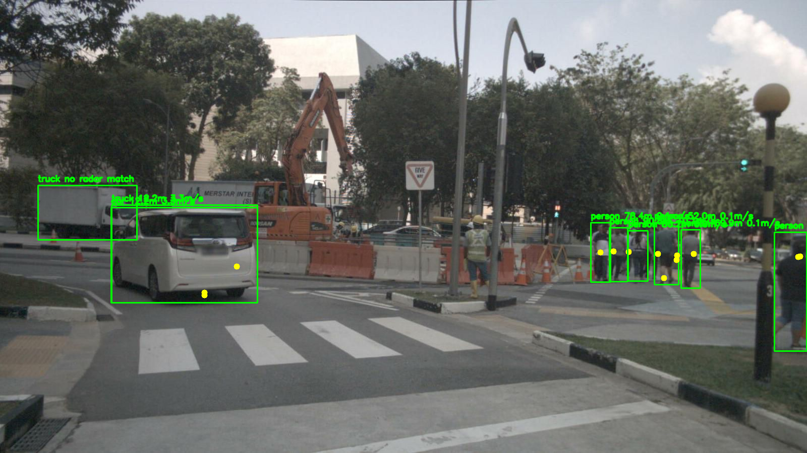
  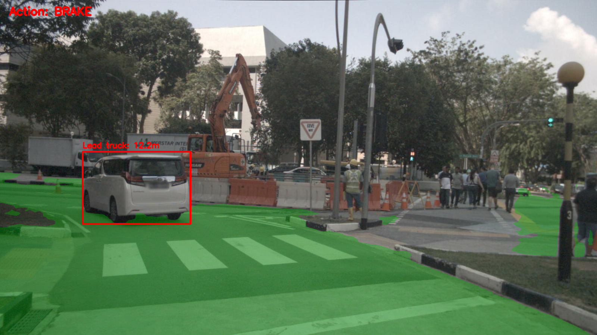
</p>
<p align="center"><em>Left: YOLO detections fused with projected radar points (distance and relative velocity per object). Right: drivable area (green), selected lead vehicle at 12.2 m, and the resulting <code>BRAKE</code> decision.</em></p>

> **Scope:** This is a research and learning proof of concept. It runs offline on recorded data and in a 1-D simulator. It has not been tested on a real vehicle and must not be used for vehicle control.

---

## Table of Contents

- [Highlights](#highlights)
- [Pipeline](#pipeline)
- [Project Phases](#project-phases)
- [Results by Phase](#results-by-phase)
- [Reinforcement-Learning ACC Results](#reinforcement-learning-acc-results)
- [Repository Structure](#repository-structure)
- [Getting Started](#getting-started)
- [Limitations](#limitations)
- [Future Work](#future-work)
- [Acknowledgements](#acknowledgements)

---

## Highlights

- **Multi-modal perception:** YOLO11n object detection + SegFormer-B0 (Cityscapes) semantic segmentation + nuScenes `RADAR_FRONT` point clouds.
- **Calibrated sensor fusion:** radar points are transformed *radar → ego → global → ego → camera → pixels* using the nuScenes extrinsics, ego poses and camera intrinsics, then associated with detection boxes.
- **Lead-vehicle scene state:** the nearest radar-matched vehicle whose footprint lies on the drivable road inside a forward look-ahead region.
- **Two controllers:** an interpretable distance/TTC rule baseline and a PPO agent trained in a custom Gymnasium ACC environment.
- **Honest evaluation:** development / validation / final-test replay split on real nuScenes scenes, plus 100 held-out randomized simulator episodes for PPO.

---

## Pipeline

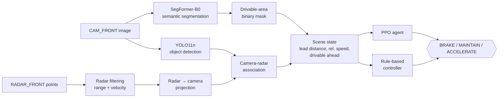

Example of the final fused output for one frame:

```json
{
  "lead_present": true,
  "lead_class": "truck",
  "lead_distance_m": 12.18,
  "lead_relative_speed_mps": 3.28,
  "ego_speed_mps": 13.9,
  "drivable_ahead": true,
  "recommended_action": "BRAKE"
}
```

---

## Project Phases

| Phase | Goal | Method | Script(s) | Main output |
| :---: | --- | --- | --- | --- |
| **0** | Dataset exploration | Load nuScenes mini, verify calibration, timestamps and ego pose; project 3D ground-truth boxes | `phase0_dataset_check.py`, `phase0_visualize_annotations.py`, `phase0_visualize_radar.py`, `phase0_project_radar_to_camera.py` | `outputs/phase0/` |
| **1** | Camera object detection | Pretrained **YOLO11n**, filtered to car, truck, bus, person, bicycle, motorcycle | `phase1_object_detection.py` | `outputs/detections/` |
| **2** | Semantic segmentation | **SegFormer-B0** fine-tuned on Cityscapes (19 classes) | `phase2_semantic_segmentation.py` | `outputs/segmentation/` |
| **3** | Drivable-area extraction | Cityscapes `road` class → binary mask (1 = drivable) | `phase3_drivable_area.py` | `outputs/drivable_area/` |
| **4** | Radar processing | Filter `RADAR_FRONT` points (2–100 m, valid states), compute range and compensated velocity | `phase4_radar_processing.py` | `outputs/radar/` |
| **5A** | Radar-to-camera projection | Radar → ego → global → ego(cam time) → camera → image pixels | `phase5a_radar_to_camera_projection.py` | `outputs/fusion/*_radar_projection.png` |
| **5B** | Camera-radar association | Radar points inside each YOLO box; median range and velocity per object | `phase5b_camera_radar_association.py` | `outputs/fusion/*_fused_obstacles.json` |
| **6** | Scene state + rule decision | Lead-vehicle selection on drivable road; rules on distance and TTC | `phase6_scene_state.py`, `phase6_rule_based_decision.py`, `phase6_multi_sample_evaluation.py` | `outputs/decision/`, `outputs/evaluation/` |
| **7A–D** | Real-data replay | Run phases 1–6 over continuous keyframes of three held-out scenes; plot and track the lead | `phase7a`–`phase7d_*.py` | `outputs/replay/` |
| **7E–F** | ACC simulator + rule baseline | Custom Gymnasium 1-D ACC environment (0.2 s step), seeded from real samples | `phase7e_acc_environment.py`, `phase7f_evaluate_rule_controller.py` | `outputs/rl_baseline/` |
| **7G–H** | PPO training + evaluation | Stable-Baselines3 PPO, 50k steps, 4 envs; fixed and randomized evaluation | `phase7g_train_ppo.py`, `phase7h_evaluate_randomized_ppo.py` | `outputs/ppo*/` |
| **7I** | Perception → PPO bridge | Feed a real Phase 6 state to the trained PPO policy | `phase7i_perception_to_ppo.py` | `outputs/ppo_inference/` |

Detailed write-ups for each phase are in `phase2.md` and `phase3_implementation.md` through `phase7_rl_implementation.md`. Final numbers are in [`phase7_final_results.md`](phase7_final_results.md).

---

## Results by Phase

Images from Phase 1 onward come from the same nuScenes keyframe (`sample 014`) unless noted.

### Phase 0: Dataset and calibration check (`sample 0`)

| Ground-truth 3D boxes projected into `CAM_FRONT` | Raw radar points projected into `CAM_FRONT` |
| :---: | :---: |
| 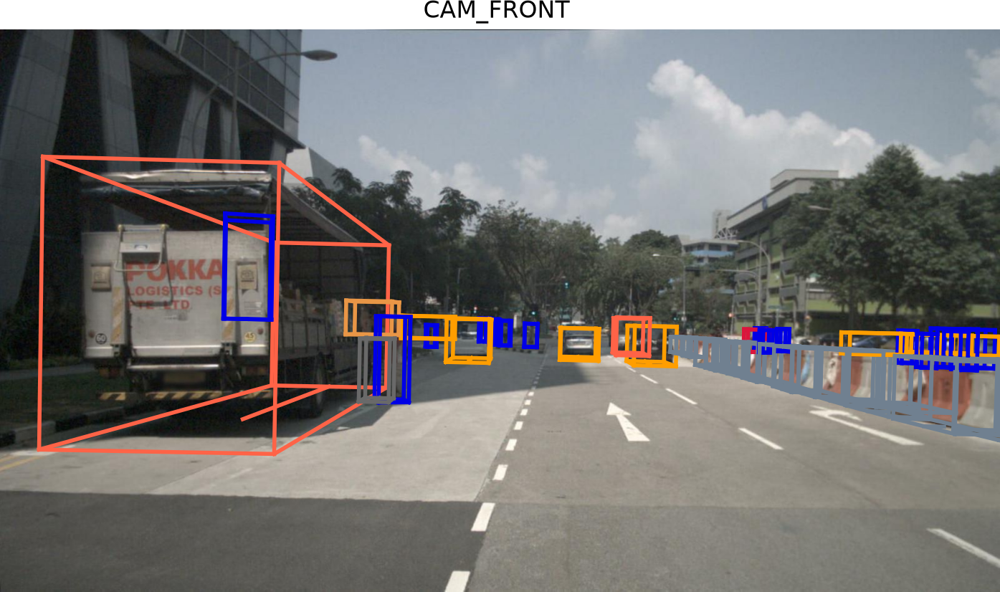 | 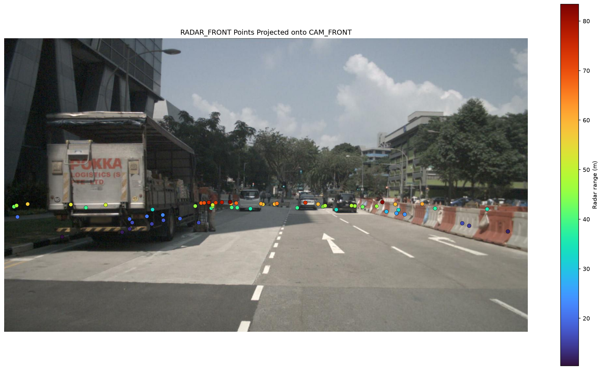 |

### Phase 1 and 2: Detection and semantic segmentation

| YOLO11n detections | SegFormer-B0 semantic segmentation |
| :---: | :---: |
| 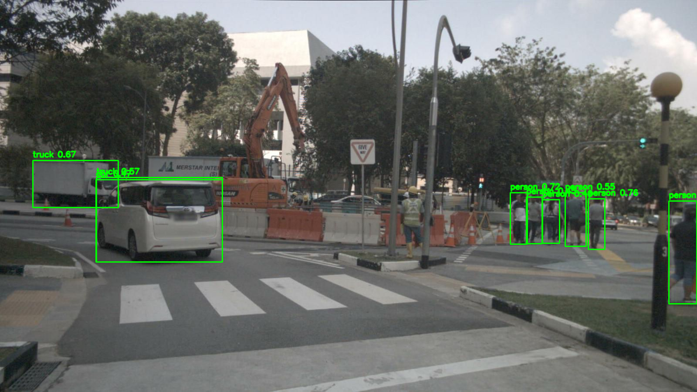 | 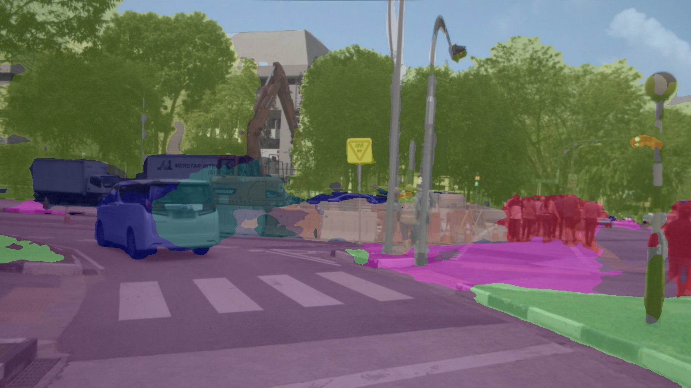 |

### Phase 3 and 4: Drivable area and radar

| Drivable-area mask (road class) | Filtered `RADAR_FRONT` targets (top-down, coloured by velocity) |
| :---: | :---: |
| 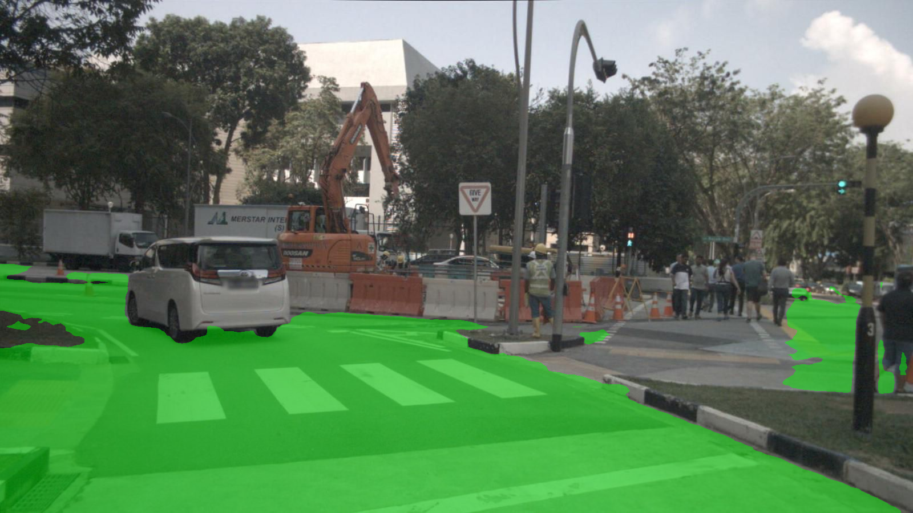 | 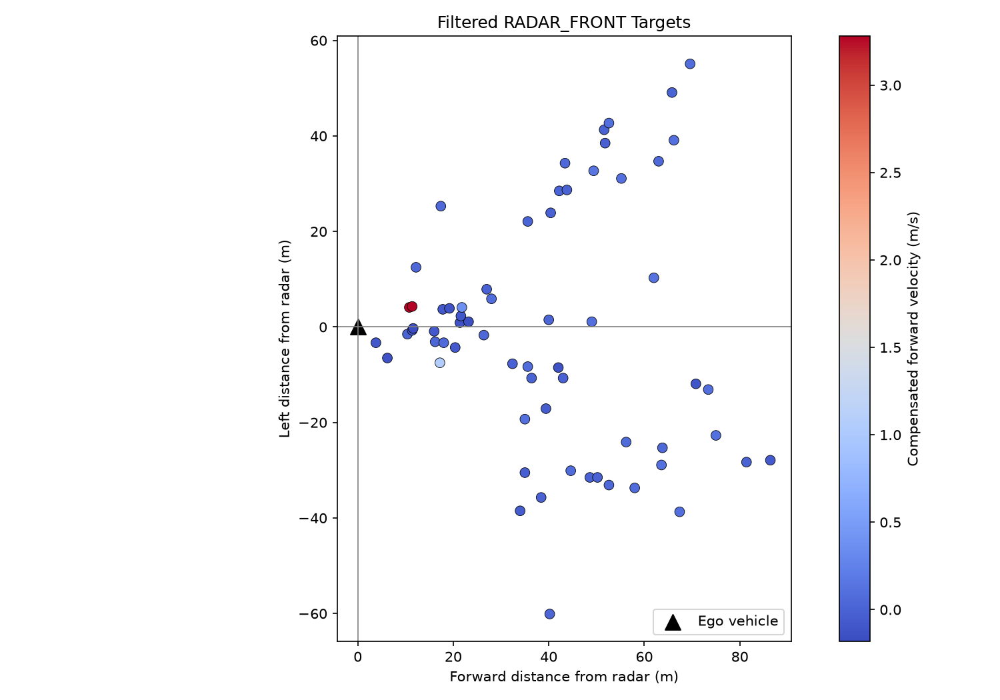 |

### Phase 5: Camera-radar fusion

| 5A: Radar projected onto the image | 5B: Radar associated with detections |
| :---: | :---: |
| 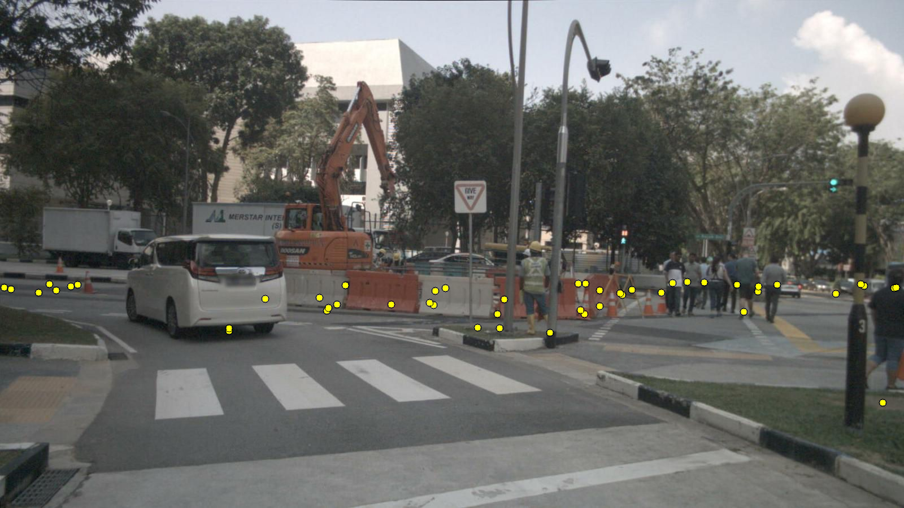 |  |

### Phase 6: Scene state and rule-based decision

Rule controller:

```text
lead gap <= 12 m  OR  0 < TTC <= 4 s   ->  BRAKE
lead gap <= 30 m                       ->  MAINTAIN
otherwise / no lead                    ->  ACCELERATE
```

| Sample 014: close lead → `BRAKE` | Sample 308 (validation scene): closing lead → `BRAKE` |
| :---: | :---: |
|  | 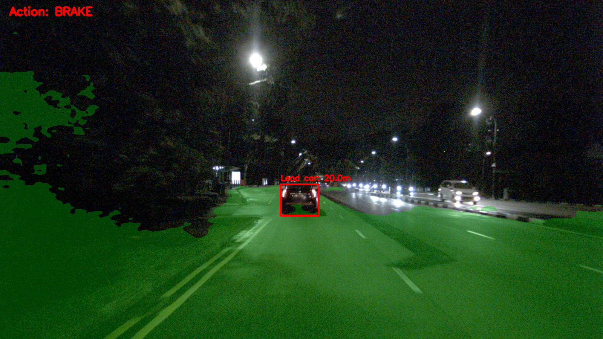 |

Multi-sample check (`outputs/evaluation/phase1_to_6_evaluation.md`):

| Sample | Detections | Radar matches | Lead object | Lead distance (m) | Action |
| :---: | :---: | :---: | :---: | :---: | :---: |
| 60 | 9 | 6 | car | 31.36 | ACCELERATE |
| 61 | 10 | 5 | car | 35.95 | ACCELERATE |
| 62 | 9 | 5 | car | 26.22 | MAINTAIN |

### Phase 7A–D: Camera-radar replay on held-out scenes

The design was frozen on the development scene before the validation and final-test scenes were processed. The final-test scene was run once.

| Role | Scene | Keyframes | Lead selected | Radar-matched detections | Lead-distance range | BRAKE | MAINTAIN | ACCELERATE |
| --- | --- | :---: | :---: | :---: | --- | :---: | :---: | :---: |
| Development | `scene-0061` | 27 | 27 / 27 | 77 | 4.85 – 56.13 m | 9 | 9 | 9 |
| Validation | `scene-1077` | 38 | 36 / 38 | 74 | 15.15 – 84.09 m | 31 | 0 | 7 |
| Final test | `scene-1094` | 35 | 29 / 35 | 88 | 4.83 – 68.61 m | 11 | 5 | 19 |

<p align="center">
  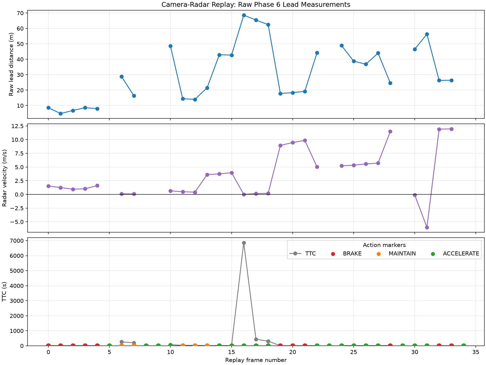
</p>
<p align="center"><em>Final-test replay (scene-1094): raw per-frame lead distance, radar velocity and TTC with the rule action. Jumps show lead re-selection between objects, because there is no motion-model tracker yet.</em></p>

<details>
<summary>Development and validation replay plots</summary>

| Development: `scene-0061` | Validation: `scene-1077` |
| :---: | :---: |
| 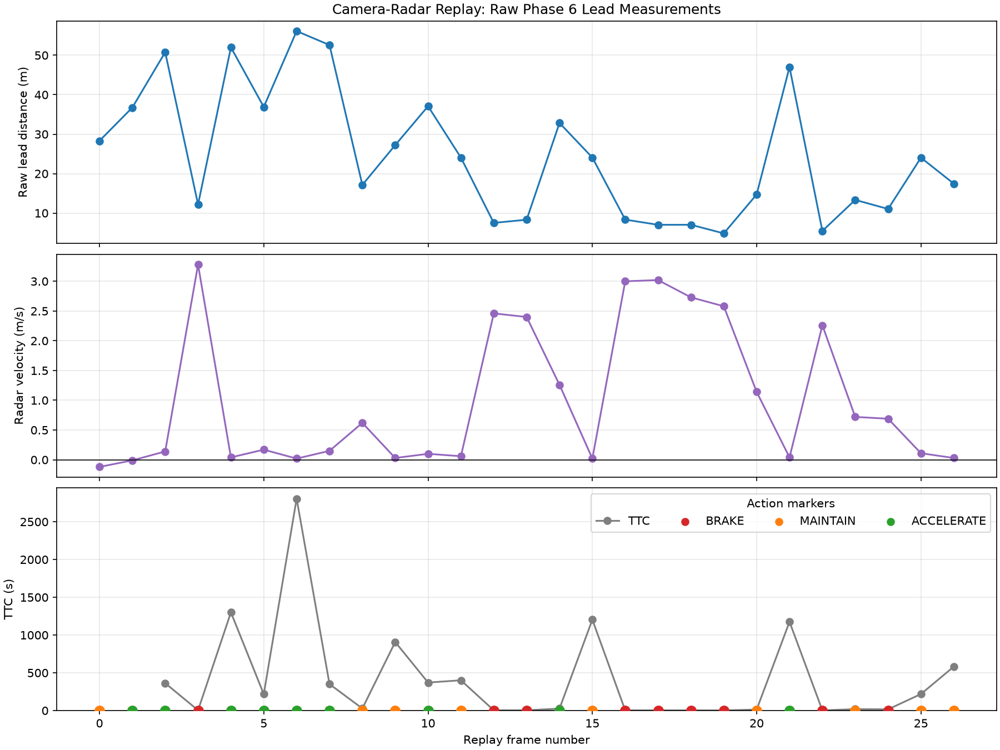 | 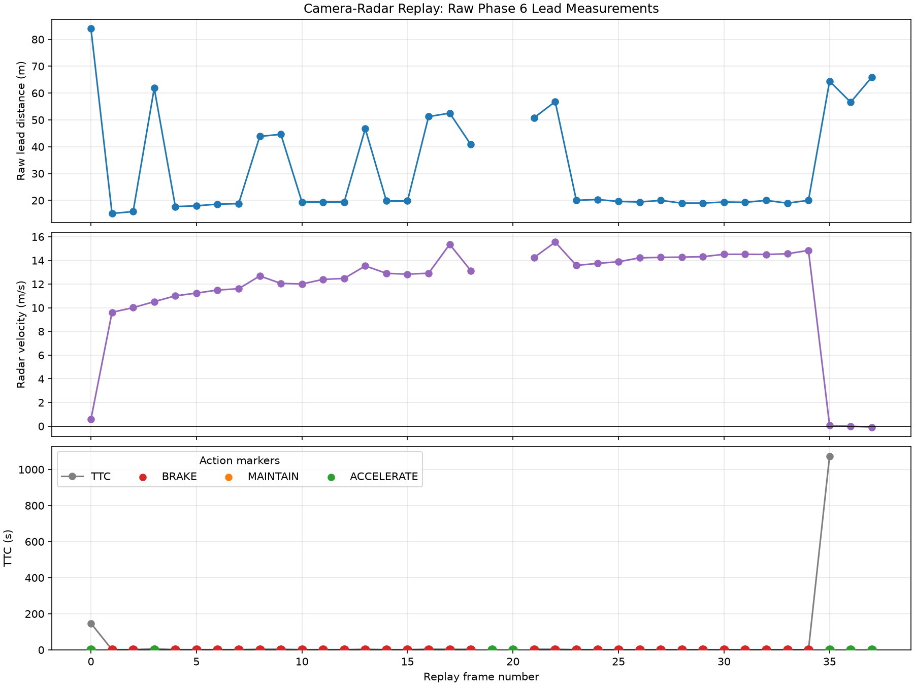 |

</details>

---

## Reinforcement-Learning ACC Results

nuScenes recordings cannot train a controller directly, because recorded vehicles do not react to the agent's actions. A small **Gymnasium** environment (one straight lane, ego + lead vehicle, 0.2 s step, 150 steps) is therefore used for training. Its episodes are seeded with realistic values taken from the perception pipeline.

**Observation** (same format as the Phase 6 scene state):

```text
[lead_present, lead_distance_m, closing_speed_mps, ego_speed_mps, drivable_ahead]
```

**Actions:** `BRAKE`, `MAINTAIN`, `ACCELERATE`. **Reward:** positive for safe forward progress near a speed-dependent desired gap; penalties for following too closely, falling too far behind, changing action and a large penalty for collisions.

### Fixed real-data-seeded scenarios: rule vs. PPO

| Scenario | Controller | Collision | Final gap | Desired gap | Total reward |
| --- | --- | :---: | :---: | :---: | :---: |
| `sample_012` neutral following | Rule | No | 18.27 m | 16.80 m | 120.211 |
| `sample_012` neutral following | **PPO** | No | 19.29 m | 20.85 m | **158.447** |
| `sample_014` close following | Rule | No | 31.62 m | 17.70 m | 49.451 |
| `sample_014` close following | **PPO** | No | 14.94 m | 15.45 m | **145.552** |

| Rule baseline: `sample_014` | PPO: `sample_014` |
| :---: | :---: |
| 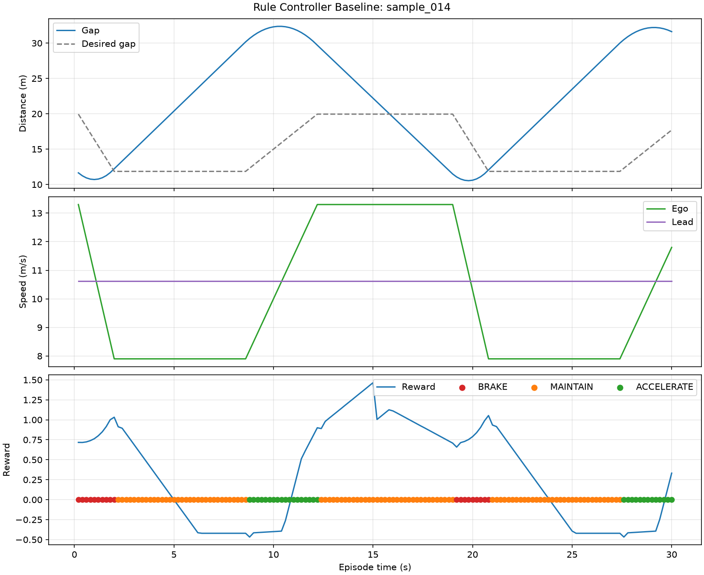 | 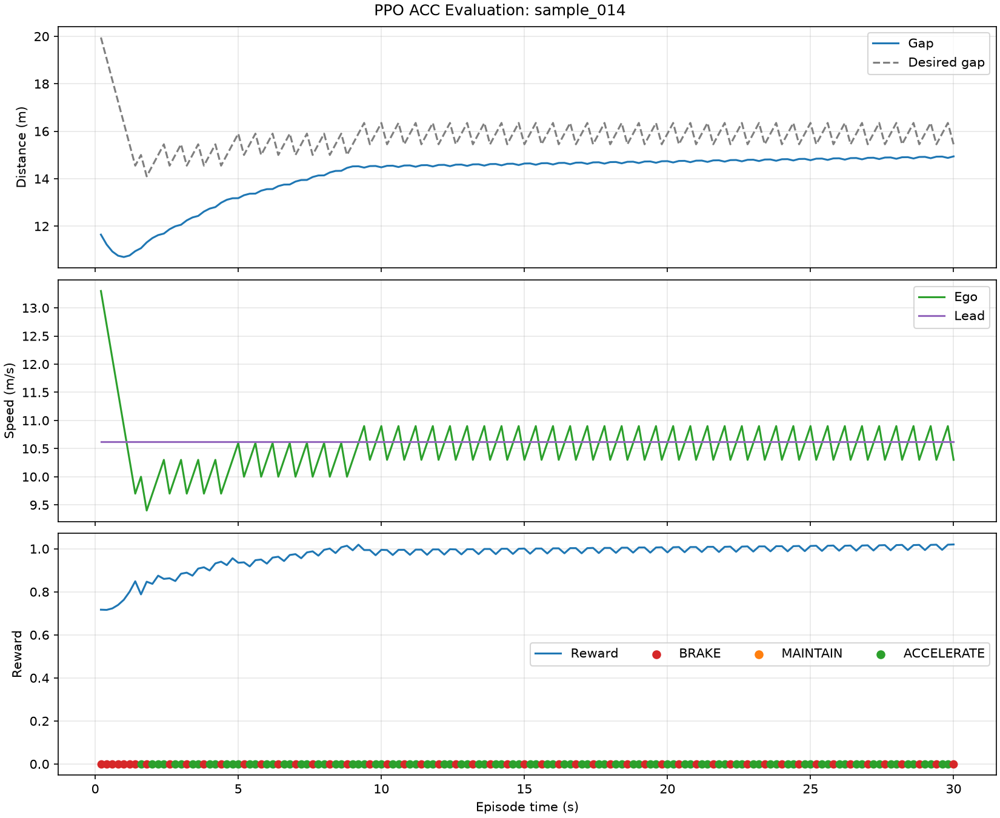 |

The PPO agent settles close to the desired gap, while the threshold controller drifts far behind the lead.

### Reward-design iterations

Each experiment is kept in its own folder so the results can be compared side by side.

| Experiment | `sample_012` final gap / reward | `sample_014` final gap / reward | Outcome |
| --- | :---: | :---: | --- |
| `outputs/ppo/` (initial) | 82.11 m / 17.3 | 62.76 m / 24.5 | Safe but far too conservative |
| `outputs/ppo_tuned_reward/` | collision / −72.8 | collision / −265.3 | Too aggressive |
| `outputs/ppo_gap_tuned/` | 36.75 m / −0.8 | 37.26 m / 33.2 | Safe, still too far behind |
| `outputs/ppo_approach_tuned/` · `ppo_approach_tuned2/` (final) | **19.29 m / 158.4** | **14.94 m / 145.6** | Tracks the desired gap, no collision |

### Randomized held-out evaluation (final model)

100 unseen randomized episodes (reset seeds 1000–1099), no retraining:

| Metric | Result |
| --- | :---: |
| Episodes (with lead / without lead) | 100 (86 / 14) |
| Collisions | 5 (**5.0 %** overall, 5.81 % of lead episodes) |
| Mean total reward | 69.58 |
| Mean final gap error (lead episodes) | 4.60 m |
| Mean action changes per episode | 67.5 |

### End-to-end: real frame → PPO action

Validation frame `sample 308` (`scene-1077`) → Phase 6 state → PPO observation `[1, 20.04 m, 13.58 m/s, 13.9 m/s, 1]` → **`BRAKE`** (`outputs/ppo_inference/cam_front_sample_308_ppo_action.json`).

---

## Repository Structure

```text
.
├── phase0_*.py                     # dataset, annotation and radar sanity checks
├── phase1_object_detection.py      # YOLO11n detection
├── phase2_semantic_segmentation.py # SegFormer-B0 (Cityscapes)
├── phase3_drivable_area.py         # road mask extraction
├── phase4_radar_processing.py      # radar filtering, range, velocity
├── phase5a_radar_to_camera_projection.py
├── phase5b_camera_radar_association.py
├── phase6_scene_state.py           # lead-vehicle selection
├── phase6_rule_based_decision.py   # rule controller
├── phase6_multi_sample_evaluation.py
├── phase7a…7d_*.py                 # replay manifest, pipeline, plots, tracking
├── phase7e_acc_environment.py      # Gymnasium ACC environment
├── phase7f_evaluate_rule_controller.py
├── phase7g_train_ppo.py            # PPO training + fixed-scenario evaluation
├── phase7h_evaluate_randomized_ppo.py
├── phase7i_perception_to_ppo.py    # real state → PPO action
├── models/segformer-b0-cityscapes/ # model config (weights not tracked)
├── outputs/                        # all generated images, JSON, CSV, PPO models
├── commands.md                     # full command reference
├── challenges.md                   # design challenges and trade-offs
├── phase*_implementation.md        # per-phase notes
└── phase7_final_results.md         # frozen final evaluation
```

---

## Getting Started

### 1. Environment

```bash
python -m venv .venv
source .venv/bin/activate          # Windows: .venv\Scripts\activate
pip install nuscenes-devkit ultralytics transformers torch \
            opencv-python matplotlib numpy pyquaternion pillow \
            gymnasium stable-baselines3==2.9.0
```

### 2. Data and models

- Download **nuScenes v1.0-mini** from [nuscenes.org](https://www.nuscenes.org/nuscenes#download) and extract it to `data/nuscenes_dataset/v1.0-mini/`.
- Download the SegFormer weights (`nvidia/segformer-b0-finetuned-cityscapes-1024-1024` on Hugging Face) into `models/segformer-b0-cityscapes/`. The configs are already in the repo.
- `yolo11n.pt` is downloaded automatically by Ultralytics on first run.

### 3. Run

```bash
# Single frame, phases 1-6 (default sample 95)
python phase1_object_detection.py --sample-index 14
python phase2_semantic_segmentation.py --sample-index 14
python phase3_drivable_area.py --sample-index 14
python phase4_radar_processing.py --sample-index 14
python phase5a_radar_to_camera_projection.py --sample-index 14
python phase5b_camera_radar_association.py --sample-index 14
python phase6_scene_state.py --sample-index 14
python phase6_rule_based_decision.py --sample-index 14

# Or the whole chain for several frames + summary table
python phase6_multi_sample_evaluation.py --sample-indices 0 50 95

# RL
python phase7f_evaluate_rule_controller.py
python phase7g_train_ppo.py --timesteps 50000 --num-envs 4 --output-directory outputs/ppo_approach_tuned2
python phase7h_evaluate_randomized_ppo.py --model-directory outputs/ppo_approach_tuned2 --episodes 100 --seed 1000
python phase7i_perception_to_ppo.py --sample-index 308 --model-directory outputs/ppo_approach_tuned2
```

See [`commands.md`](commands.md) for every option, including the replay pipeline (Phase 7A–D).

---

## Limitations

- **Association:** a radar point inside a 2D box is a heuristic. Overlapping objects and roadside clutter can cause mismatches, and some visible vehicles get no radar match.
- **No tracking filter:** the replay lead can jump between objects from frame to frame. There is no Kalman or radar-gated multi-object tracker yet.
- **Velocity convention:** radar relative velocity is passed to PPO as closing speed without calibrating its sign or physical meaning.
- **Ego speed** is a fixed assumption (13.9 m/s) in the Phase 6 state instead of CAN-bus data.
- **Simulator:** one-dimensional, a single lead vehicle, no steering or road geometry.
- **PPO:** three discrete actions cause frequent brake/accelerate switching, and the model collided in 5 of 100 randomized episodes.
- **Data:** only nuScenes v1.0-mini was used, and the validation and test scenes come from the same recording day.

## Future Work
- Continuous acceleration actions (e.g. SAC/TD3) and safety-shielded RL to remove collisions.
- Quantitative range and association error against nuScenes 3D annotations on the full `trainval` split.
- Bird's-eye-view fusion and 3D detection as a separate extension.

## Acknowledgements

- [nuScenes](https://www.nuscenes.org/) by Motional. The dataset is used under its [terms of use](https://www.nuscenes.org/terms-of-use) (CC BY-NC-SA 4.0).
- [Ultralytics YOLO](https://github.com/ultralytics/ultralytics), [SegFormer](https://huggingface.co/nvidia/segformer-b0-finetuned-cityscapes-1024-1024) (NVIDIA, via Hugging Face Transformers), [Stable-Baselines3](https://github.com/DLR-RM/stable-baselines3) and [Gymnasium](https://gymnasium.farama.org/).

The previous planning notes are kept in [`README_old.md`](README_old.md).
